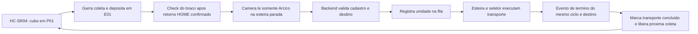

# Operacao automatica por presenca e identificacao

O Dashboard acompanha a operacao. Nao ha planejamento manual de produtos,
quantidades ou botoes de partida/parada/reset no bloco da camera.



Somente um cubo pode estar em operacao. O HC-SR04 detecta presenca, nao identifica
o produto. A identificacao e feita pela camera depois da coleta, em E01. A fila
mostra cada unidade identificada, inclusive repeticoes do mesmo produto, com
ciclo, regiao, destino e resultado persistidos no SQLite.

Um ACK confirma recebimento do comando, nao conclusao. O backend aguarda
`EVT:<ciclo>:DESTINO_ALCANCADO:<Rxx>` do controlador da esteira. O evento deve
corresponder ao ciclo e destino ativos, e o comando de parada deve ser confirmado.
O check do braco e independente: vem de `GARRA_RETORNOU`, depois de coleta,
entrega e retorno HOME confirmados. Os cards e a fila mostram esse check mesmo
enquanto o transporte esta pendente ou em andamento. `braco_concluido` e
`transporte_estado` ficam separados na API. Uma falha na esteira nao desfaz a
conclusao do braco nem pode ser apresentada como transporte concluido.
Somente apos o termino da esteira o ciclo de transporte fica FINALIZADO e a
proxima caixa e liberada. O check do braco nao autoriza uma nova coleta.
No EV3, este evento vem do fim de toda a sequencia calibrada de motores e seletor;
nao equivale a uma medicao fisica de chegada do cubo.

## Servidor e dispositivos

`python start.py` inicia o Flask e o observador automatico no mesmo processo,
sem reloader. Nao e necessario iniciar outro Flask local para a esteira.
O Flask recebe status e envia comandos pelos adaptadores existentes:

- Arduino da garra e HC-SR04: serial CMD/ACK/EVT/ERR e mensagens SENSOR.
- EV3 real: bridge TCP autenticado em `ev3/server.py`, executado no EV3.
- Bancada: servidores Arduino e EV3 virtuais iniciados junto com o Flask.

O EV3 usa Pybricks/MicroPython; seu bridge deve estar executando na placa. Iniciar
um Flask no computador nao inicia remotamente o programa nem os motores do EV3.
O transporte real existente foi preservado. Para validar o comportamento do
servidor sem placa, use `CONVEYOR_MODE=ev3_simulator`: a aplicacao inicia o servidor
TCP da esteira em localhost e uma porta livre, usando os mesmos comandos/eventos.

## HC-SR04 e firmware

O HC-SR04 nao se conecta ao Flask por HTTP. Ele fica ligado ao Arduino; o
firmware mede a distancia e informa a presenca pela USB/serial. O backend recebe
as mensagens em segundo plano e autoriza a garra somente quando o fluxo esta
pronto. O Arduino nao deve executar coleta autonoma em paralelo com o backend.

TRIG D8 e ECHO D9. Grave a versao atual de
`arduino/mearm_calibrador/mearm_calibrador.ino`, mantendo os headers da mesma pasta.
O backend habilita o sensor com o comando correlacionado:

```text
CMD:PRESENCA:PRESENCA:CONFIGURAR:10:3000
ACK:PRESENCA:PRESENCA:CONFIGURAR:10:3000
SENSOR:PRESENTE:7
SENSOR:AUSENTE:-1
```

A distancia padrao e 10 cm; a presenca precisa ficar estavel por 3000 ms.
`PRESENCE_DISTANCE_CM` aceita 2 a 100; `PRESENCE_STABLE_MS` aceita 3000, 4000 ou 5000.
O firmware preserva as posicoes e a calibracao existentes na EEPROM. A ativacao
automatica do sensor nao regrava a EEPROM a cada inicializacao.

Uma presenca mantida nao dispara outra coleta. Eventos de presenca ocorridos
durante o ciclo sao descartados para fins de nova coleta; retire e reposicione
uma caixa apresentada antecipadamente depois da liberacao.

## Inicializacao fisica

Depois de conferir calibracao, posicoes e conexoes, configure no PowerShell:

```powershell
$env:HARDWARE_MODE = "serial"
$env:ARDUINO_PORT = "COM3" # Substituir pela porta real.
$env:GRIPPER_PROFILE_CALIBRATED = "1" # Apenas com calibracao validada na placa.
$env:CONVEYOR_MODE = "ev3"
$env:EV3_HOST = "<IP_DO_EV3>"
$env:EV3_TOKEN = "<MESMA_CHAVE_DO_EV3>"
$env:CAMERA_MODE = "opencv"
$env:CAMERA_INDEX = "1" # Logi C270 nesta montagem; conferir em outra maquina.
$env:AUTO_OPERATION = "1"
$env:ARRIVAL_SENSOR_MODE = "conveyor"
$env:REQUIRE_PHYSICAL_ARRIVAL = "0"
.\.venv\Scripts\python.exe start.py
```

O modo padrao de conclusao aceita o evento de movimento do controlador.
Para exigir sensores adicionais nas saidas, habilite `REQUIRE_PHYSICAL_ARRIVAL=1`
e `ARRIVAL_SENSOR_MODE=arduino`; esses sensores sao independentes do HC-SR04 de P01.

## Validacao sem motores

```powershell
.\.venv\Scripts\python.exe -m scripts.bancada --smoke-test
.\.venv\Scripts\python.exe -m scripts.bancada --port 5001
```

A bancada inicia os dois servidores de dispositivos e o Flask. Para apresentar
uma unidade na camera mock, e depois disparar presenca, use outro PowerShell:

```powershell
Invoke-RestMethod http://127.0.0.1:5001/api/simulation/camera -Method Post -ContentType application/json -Body '{"produto_id":"TESTE-CE"}'
Invoke-RestMethod http://127.0.0.1:5001/api/simulation/presence -Method Post -ContentType application/json -Body '{"presente":true}'
```

A simulacao disponibiliza a etiqueta antecipadamente, mas ela so e consumida
depois que a garra confirma a entrega. Espere `proxima_caixa_liberada=true` em
`GET /api/queue` antes da proxima unidade; envie `presente:false`, a nova etiqueta
e `presente:true`. As entradas simuladas sao rejeitadas para camera/Arduino reais.

## Falhas e recuperacao

Etiqueta desconhecida ou ilegivel apos a coleta mantem a esteira parada e bloqueia
a proxima unidade. Perda de conexao, evento de outra regiao/ciclo e falta do evento
de conclusao tambem nao liberam o sensor. Reiniciar o servidor nao repete uma
coleta interrompida. Filas manuais antigas permanecem no banco, sem serem executadas.

As APIs de manutencao continuam disponiveis. Apos inspecionar e reposicionar
fisicamente o cubo, use `POST /api/system/stop`, aguarde a parada do worker,
`POST /api/system/reset` e `POST /api/flow/start`. O reset nao executa homing fisico.
`AUTO_OPERATION=0` impede a ativacao automatica ao iniciar o Flask durante manutencao.
`POST /api/queue` e tentativas de reenfileirar manualmente retornam AUTOMATIC_QUEUE.
